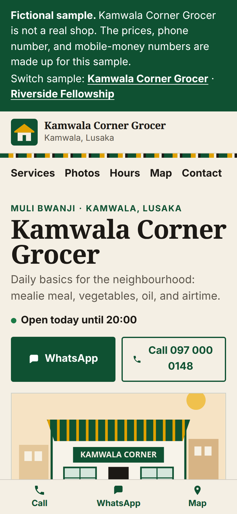
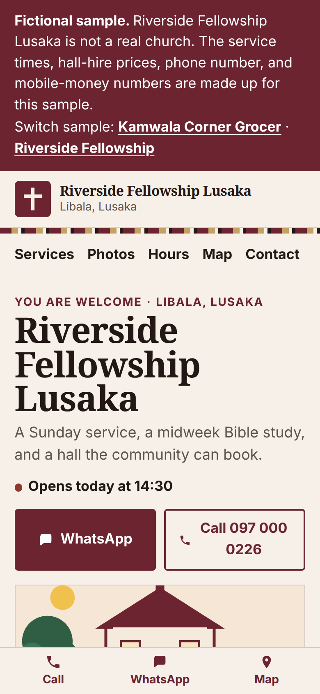

# Lusaka business website template

A phone-first website for a small Lusaka business: a shop, a church, a salon, or a lodge. The name, prices, hours, photos, map, and contact buttons all come from one config file. There is no build step. The page is plain HTML, CSS, and JavaScript, and the links are relative so it can be served from a GitHub Pages project folder such as `/lusaka-business-website-template/`.

## Who it is for

Wankumbu Musunga ([@MKBright](https://github.com/MKBright)) is an entry-level computer science student in Lusaka. This template is what he can sell to a neighbourhood business that needs a page people can open on a phone, on a slow connection, and immediately call or WhatsApp.

You can reuse it for your own clients. Leave the footer line **Website by Wankumbu Musunga** in place so the next reader can find the person who made the template.

## Samples

Both businesses are fictional. Nothing on these pages is a real shop, church, phone number, or mobile-money account.

- Kamwala Corner Grocer, a grocery shop: `?demo=kamwala`
- Riverside Fellowship Lusaka, a church: `?demo=chapel`

`?demo=shop` is the grocer and `?demo=church` is the fellowship. Any other value is ignored, so a query string cannot point the page at a file outside the two samples.

After GitHub Pages is turned on, the samples are:

- https://mkbright.github.io/lusaka-business-website-template/?demo=kamwala
- https://mkbright.github.io/lusaka-business-website-template/?demo=chapel

Phone-width screenshots:





The drawings in the photo slots are samples. A client site uses real photographs.

## Make a client site in about 10 minutes

Do this once the owner has given you the name, a price list, a phone number, and a few photos.

1. Copy `demos/kamwala-grocer.json` to `site.json` in the project root. A salon or a lodge uses the same file: change the services to treatments or rooms, and set `schemaType` to `HairSalon` or `LodgingBusiness`. A church can start from `demos/riverside-fellowship.json` instead.
2. Edit `site.json`.
   - `name`, `tagline`, and `greeting`
   - `theme` colours as `#RRGGBB`
   - `services`: each item has `name`, `detail`, and `priceZmw` (a number, or `null` for free). `priceLabel` replaces the number, for example `"From K5"` or `"Gift"`.
   - `hours`: seven days. Use `"open": null` and `"close": null` for a closed day. Times are 24-hour `HH:MM` in Lusaka.
   - `gallery`: the first image is the hero. Each item needs `src` and `alt`.
   - `location.address`, `area`, `city`, `lat`, and `lng`. The map pin and the Google Maps link are built from the coordinates.
   - `contact.phone` (with country code, `+260…`), `phoneDisplay`, `whatsapp`, and `whatsappMessage`.
   - `payments`: the MTN MoMo and Airtel Money numbers, shown as text. This page does not take the money.
   - `socials`: `name` and an `https` URL.
   - `seo.title` and `seo.description`.
3. Set `"fictional": false` when the page is about a real business. While it is `true`, a sample banner stays on the page. That is deliberate, so a demo number is not mistaken for a real till.
4. Put the client's photos in `assets/photos/` and point `logo`, `favicon`, and `gallery` at them. Keep each photo under about 200KB and around 1200 pixels wide so the page stays quick on mobile data. JPG or WebP is a better photo format than the sample SVGs.
5. In `index.html`, change the config pointer from the sample to the client file:

   ```html
   <meta name="site-config" content="site.json">
   ```

   Also paste `seo.title` and `seo.description` into the `<title>`, `description`, and Open Graph tags. WhatsApp and Facebook read those tags and do not run the page's JavaScript, so a preview will stay on the sample text until you edit them.
6. Preview, then check on a phone: tap Call, tap WhatsApp (the message should already be filled in), and open the map.

`?demo=kamwala` and `?demo=chapel` still open the built-in samples, which is useful while you are selling. Delete the `demos` folder on a published client site if those links should stop working.

### Preview on your computer

The browser blocks the config file if you double-click `index.html`. Start a small server from the project folder:

```bash
python3 -m http.server 8080
```

Open http://localhost:8080/ for the file named in `site-config`, http://localhost:8080/?demo=kamwala for the grocer, and http://localhost:8080/?demo=chapel for the church.

If the page says the JSON is invalid, look for a missing comma or a trailing comma. The message names the field when a value has the wrong shape.

## Deploy on GitHub Pages

1. Create a repository. `lusaka-business-website-template` matches the path this project expects for its 404 page. Another name works for the home page because asset links are relative; the 404 "back" link looks for this folder name and otherwise uses `./`.
2. Push the `main` branch.
3. In the repository, open Settings → Pages → Build and deployment → Deploy from a branch. Choose `main` and `/ (root)`, then save.
4. A few minutes later the site is at `https://<username>.github.io/<repository>/`.
5. `.nojekyll` is already in the project so GitHub Pages will not run Jekyll or hide files.

GitHub Pages hosting for a public repository is free. A custom domain is optional and is not part of the first setup.

There is also a `404.html` page. On GitHub Pages it is shown when someone opens an address that is not on the site, with a link back home.

## Suggested pricing and care plan

These figures are **estimates, not a quote**. They are a starting point for a student in Lusaka. Say them out loud, then change them to fit the job, the travel, and how much writing and photography you do.

| Work | Estimate |
| --- | --- |
| Setup: config, photos, GitHub Pages, and showing the owner how to call and WhatsApp from the page | K1,500–K3,000 |
| Monthly care: change a price or a phone number, swap a photo, check that the link still opens | K150–K300 per month |

Charge toward the top of the setup range if you take the photos, write all the copy, or make more than one trip. Charge less for a noticeboard that rarely changes. A redesign, or a second business, is a new setup, not a care visit.

Ask for the setup fee before you publish. The care fee is optional. Some owners would rather call you when something changes.

The monthly fee pays for your time. It is not a hosting bill, and it is not a payment service. MTN MoMo and Airtel Money numbers on the page belong to the business. Customers pay the business directly. The template does not move money.

## What the page includes

- Hero with the name, a line that says whether they are open today in Africa/Lusaka time, Call, and WhatsApp
- Services or a price list in Zambian kwacha
- Photo gallery
- Opening hours, with today marked
- Address, an OpenStreetMap embed, and a Google Maps link
- Click-to-call, click-to-WhatsApp (`wa.me` with a prefilled message), and mobile-money numbers as text
- Social links
- Footer credit: [Website by Wankumbu Musunga](https://github.com/MKBright)
- Basic title, description, Open Graph tags, a favicon, and a 404 page

On a phone, Call, WhatsApp, and Map stay in a bar at the bottom. On a wider screen those actions move up next to the name.

## Tests

The checks are plain Node, with no packages to install. They confirm both demo configs, the colour contrast, that photos stay small and use relative paths, and that the WhatsApp link builder normalises Zambia numbers and encodes the message.

```bash
node --test
```

Node 20 or newer is required. GitHub Actions runs the same command on every push and pull request (`.github/workflows/test.yml`).

## Project files

| Path | Role |
| --- | --- |
| `index.html` | Page shell, SEO tags, and the `site-config` pointer |
| `404.html` | Missing-page screen, styled on its own so it still works deep in the site |
| `site.json` | Client config. You create this. It is not shipped, so the samples stay the default. |
| `demos/*.json` | Fictional grocer and church |
| `css/styles.css` | Phone-first layout. Colours come from the config. |
| `js/sitekit.js` | WhatsApp, maps, prices, hours, and config checks. No page edits. |
| `js/app.js` | Fills the page from the config |
| `assets/` | Logos and sample drawings |
